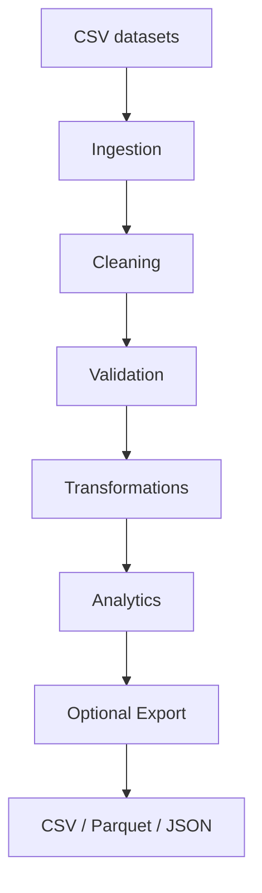

# Financial Data Processing

**A Python and Pandas data engineering project for financial
data ingestion, validation, cleaning, transformation,
analytics, and export.**

This repository demonstrates practical Python engineering
skills through a reproducible financial data pipeline
using fully synthetic datasets.

## Project Overview

The application processes customer, product, and
transaction datasets through a modular pipeline.

It validates data integrity, enriches transactions
using controlled joins, calculates analytical metrics,
and optionally exports results in CSV, Parquet, and JSON.

The project is designed for technical learning and
portfolio demonstration. It does not process real
banking or customer information.

## Technology Stack

- Python 3.12+
- Pandas
- NumPy
- PyArrow
- pytest
- JupyterLab
- GitHub Actions

## Architecture



For technical details, see [Architecture](docs/architecture.md).

## Features

### Data Ingestion
- CSV loading with Pandas.
- Explicit data type conversion.
- Required-column checks.

### Data Cleaning
- Text normalization.
- Blank value handling.
- Optional exact duplicate removal.
- Cleaning reports.

### Data Validation
- Primary key integrity.
- Required field validation.
- Foreign key validation.
- Transaction amount checks.
- Optional date validation.

### Data Transformation
- Customer and product enrichment.
- Controlled many-to-one joins.
- Merge cardinality checks.
- Unmatched reference detection.

### Financial Analytics
- Customer activity metrics.
- Product aggregation.
- Segment aggregation.
- Overall transaction indicators.

### Data Export
- CSV reports.
- Apache Parquet datasets.
- JSON summary metrics.

## Repository Structure

```text
data/          Synthetic datasets
docs/          Technical documentation
notebooks/     Reproducible Pandas examples
scripts/       Supporting utilities
src/           Application source code
tests/         Automated tests
.github/       Continuous integration
```

## Installation

Clone the repository:

```bash
git clone https://github.com/<your-username>/financial-data-processing.git
cd financial-data-processing
```

Create a virtual environment:

```bash
python -m venv .venv
```

Activate it on Windows:

```powershell
.venv\Scripts\activate
```

Or on Linux/macOS:

```bash
source .venv/bin/activate
```

Install the project with development and notebook dependencies:

```bash
python -m pip install -e ".[dev,notebooks]"
```

## Running the Pipeline

Run the complete processing pipeline:

```bash
python -m financial_processing.main --raw-dir data/raw
```

Run with output generation:

```bash
python -m financial_processing.main --raw-dir data/raw --output-dir data/processed
```

You can also use the installed CLI command:

```bash
financial-process --raw-dir data/raw --output-dir data/processed
```

## Generated Outputs

When export is enabled, the pipeline generates:

- enriched_transactions.csv
- enriched_transactions.parquet
- customer_metrics.csv
- customer_metrics.parquet
- product_metrics.csv
- product_metrics.parquet
- segment_metrics.csv
- segment_metrics.parquet
- overall_metrics.json

Generated data is excluded from version control.

## Automated Testing

Run the complete suite:

```bash
python -m pytest -v
```

The suite covers:
- Ingestion failures.
- Invalid schemas.
- Duplicate identifiers.
- Referential integrity.
- Numeric validation.
- Cleaning behavior.
- Merge cardinality.
- Analytical calculations.
- Export round trips.
- End-to-end integration.

Before repository professionalization, 117 tests passed
in the local development environment.

GitHub Actions is configured to run tests automatically
on pushes and pull requests.

## Jupyter Notebooks

The notebooks provide practical examples of Pandas:

1. Pandas fundamentals.
2. Data cleaning.
3. Dataset merging.
4. Financial analytics.

Generate notebooks:

```bash
python scripts/create_notebooks.py
```

Launch JupyterLab:

```bash
jupyter lab
```

## Documentation

- [Architecture](docs/architecture.md)
- [Data Dictionary](docs/data_dictionary.md)
- [Engineering Development Log](docs/learning_log.md)

## Engineering Principles

- Separation of concerns.
- Explicit data validation.
- Reproducible synthetic datasets.
- Controlled transformations.
- Automated testing.
- Modular and maintainable Python code.

## Limitations

This is an educational project.

It does not include:
- Production banking integrations.
- AWS infrastructure.
- Distributed processing.
- Streaming ingestion.
- Strict accounting-grade monetary precision.
- Transactional or atomic export guarantees.

## License

See the LICENSE file for the applicable license.

## Author

Alejandro de Jesús Zepeda Flores

Python Engineering | Backend Development | Data Engineering