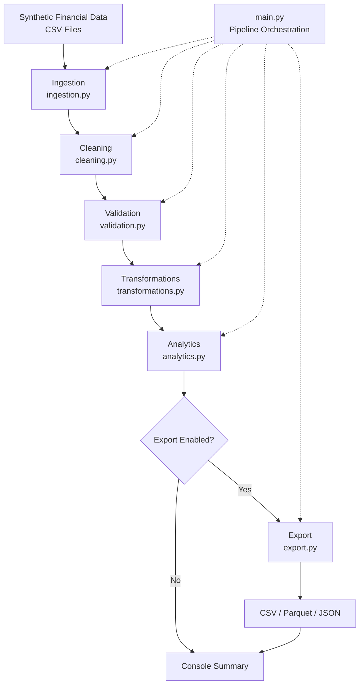
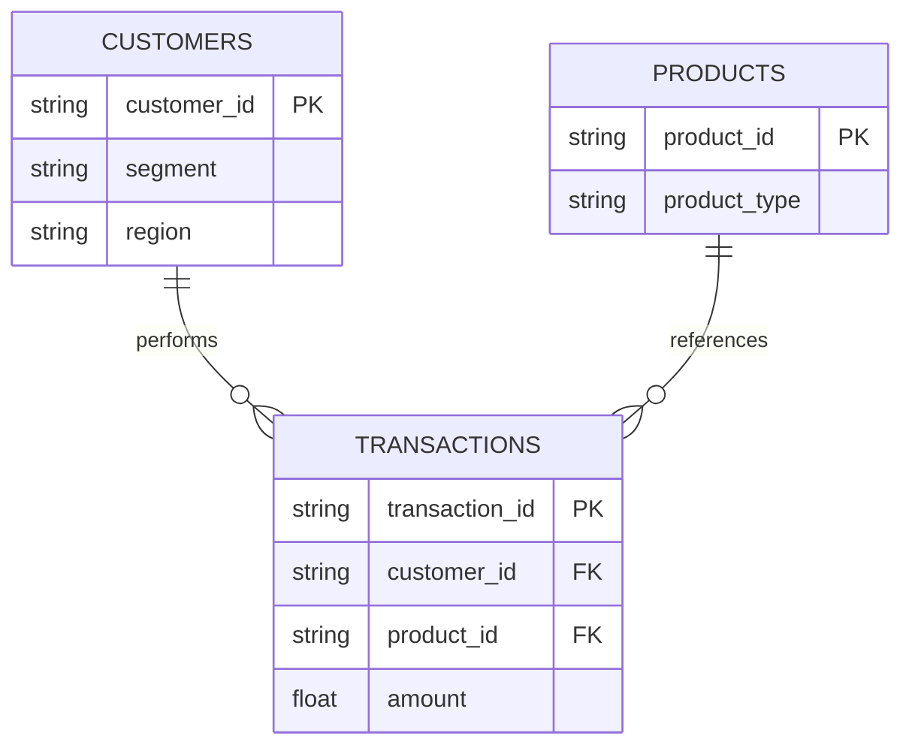

# Architecture

## 1. Overview

Financial Data Processing is a modular Python application designed to ingest, clean, validate, transform, analyze, and export synthetic financial datasets using Pandas.

The application follows a sequential data processing pipeline composed of six stages:

1. Data Ingestion
2. Data Cleaning
3. Data Validation
4. Data Transformation
5. Financial Analytics
6. Data Export

Each stage has a dedicated Python module with clearly defined responsibilities and automated tests.

## 2. System Architecture



## 3. Input Data Model

The application processes three related datasets.

### 3.1 Customers

Source: `data/raw/customers.csv`

Contains customer identifiers and classification attributes.

Primary key: `customer_id`

### 3.2 Products

Source: `data/raw/products.csv`

Contains product identifiers and product classifications.

Primary key: `product_id`

### 3.3 Transactions

Source: `data/raw/transactions.csv`

Contains financial transaction records with references to customers and products.

Primary key: `transaction_id`

Foreign keys:
- `customer_id`
- `product_id`

### 3.4 Data Relationships



All input datasets contain synthetic financial information.

## 4. Pipeline Components

### 4.1 Data Ingestion

Module: `ingestion.py`

Loads input CSV files into Pandas DataFrames.

Responsibilities:
- File existence verification.
- CSV parsing.
- Required column validation.
- Explicit data type conversion.
- String identifier preservation.
- Numeric and date conversion.

Primary functions:
- `load_csv()`
- `load_customers()`
- `load_products()`
- `load_transactions()`
- `load_datasets()`

### 4.2 Data Cleaning

Module: `cleaning.py`

Performs conservative data normalization before business validation.

Responsibilities:
- Removing surrounding whitespace.
- Converting blank strings into null values.
- Preserving original DataFrames.
- Optional exact duplicate removal.
- Generating cleaning reports.

Primary functions:
- `normalize_text_columns()`
- `remove_exact_duplicates()`
- `clean_dataset()`
- `clean_datasets()`

Exact duplicate removal is disabled by default.

### 4.3 Data Validation

Module: `validation.py`

Enforces schema consistency, data quality, and referential integrity.

Responsibilities:
- Required column validation.
- Primary key uniqueness.
- Mandatory field verification.
- Foreign key validation.
- Positive numeric amount validation.
- Finite numeric value verification.
- Optional transaction date validation.

Primary functions:
- `validate_required_columns()`
- `validate_primary_key()`
- `validate_not_null()`
- `validate_foreign_key()`
- `validate_positive_amounts()`
- `validate_dates()`
- `validate_datasets()`

Invalid data is rejected using explicit validation exceptions.

### 4.4 Data Transformations

Module: `transformations.py`

Enriches transaction records with customer and product information.

Relationships:

```text
transactions.customer_id -> customers.customer_id
transactions.product_id  -> products.product_id
```

Responsibilities:
- Pandas DataFrame joins.
- Many-to-one cardinality enforcement.
- Detection of unmatched references.
- Prevention of column collisions.
- Preservation of transaction counts.
- Non-mutating enrichment.

Primary functions:
- `merge_customers()`
- `merge_products()`
- `enrich_transactions()`

The enriched dataset combines transaction details with customer segment, region, and product classification.

### 4.5 Financial Analytics

Module: `analytics.py`

Calculates analytical indicators from enriched transactions.

Responsibilities:
- Grouping transactions.
- Aggregating financial amounts.
- Counting transactions.
- Calculating average transaction amounts.
- Counting unique customers.
- Ordering analytical results.

Primary functions:
- `calculate_customer_metrics()`
- `calculate_product_metrics()`
- `calculate_segment_metrics()`
- `calculate_overall_metrics()`
- `calculate_all_metrics()`

Main Pandas operations:
- `groupby()`
- `agg()`
- `sort_values()`
- `sum()`
- `mean()`
- `nunique()`

### 4.6 Data Export

Module: `export.py`

Serializes enriched datasets and analytical reports into standard data formats.

Supported formats:
- CSV
- Apache Parquet
- JSON

Primary functions:
- `prepare_output_directory()`
- `export_dataframe()`
- `export_overall_metrics()`
- `export_pipeline_results()`

Generated artifacts:

```text
data/processed/
├── enriched_transactions.csv
├── enriched_transactions.parquet
├── customer_metrics.csv
├── customer_metrics.parquet
├── product_metrics.csv
├── product_metrics.parquet
├── segment_metrics.csv
├── segment_metrics.parquet
└── overall_metrics.json
```

Export is optional and requires an output directory.

## 5. Pipeline Orchestration

Module: `main.py`

The application entry point coordinates all processing stages.

Execution sequence:

```python
raw_datasets = load_datasets(raw_dir)

cleaned_datasets, cleaning_reports = clean_datasets(
    raw_datasets
)

validate_datasets(cleaned_datasets)

enriched_transactions = enrich_transactions(
    cleaned_datasets
)

analytics_reports = calculate_all_metrics(
    enriched_transactions
)
```

When an output directory is provided, the pipeline additionally executes:

```python
export_pipeline_results(
    enriched_transactions,
    analytics_reports,
    output_dir,
)
```

## 6. Execution

### Install Dependencies

```bash
python -m pip install -e ".[dev,notebooks]"
```

### Run the Pipeline

```bash
python -m financial_processing.main --raw-dir data/raw
```

### Run with Export

```bash
python -m financial_processing.main --raw-dir data/raw --output-dir data/processed
```

### Remove Exact Duplicates

```bash
python -m financial_processing.main --raw-dir data/raw --drop-exact-duplicates
```

## 7. Testing Architecture

The project uses pytest for unit and integration testing.

```text
tests/
├── test_ingestion.py
├── test_validation.py
├── test_cleaning.py
├── test_transformations.py
├── test_analytics.py
├── test_export.py
└── test_main.py
```

Testing coverage includes:
- Missing input files.
- Invalid schemas.
- Duplicate identifiers.
- Null values.
- Referential integrity.
- Invalid numeric values.
- Date validation.
- DataFrame transformations.
- Merge cardinality.
- Analytical calculations.
- CSV and Parquet round trips.
- End-to-end pipeline execution.

### Execute Tests

```bash
python -m pytest -v
```

## 8. Continuous Integration

GitHub Actions executes the automated test suite on pushes and pull requests.

Workflow:

```text
.github/workflows/python-tests.yml
```

Python versions:
- Python 3.12
- Python 3.13

The workflow installs project dependencies and executes pytest.

## 9. Design Principles

### Separation of Concerns

Each pipeline stage is implemented in a dedicated module.

### Data Integrity

Schema, primary key, and foreign key constraints are verified before analytical processing.

### Explicit Error Handling

Invalid data raises descriptive exceptions rather than being silently discarded.

### Non-Mutating Operations

Cleaning, transformation, and analytics functions preserve the input DataFrames.

### Reproducibility

Synthetic datasets, declared dependencies, and automated tests support repeatable execution.

### Modularity

Each component can be imported, executed, and tested independently.

## 10. Technical Limitations

- Processing is performed locally using Pandas.
- DataFrames are processed in memory.
- The application does not implement distributed execution.
- Financial amounts use standard numeric Pandas types.
- No accounting-grade monetary precision policy is implemented.
- Exports are not transactional or atomic.
- No streaming ingestion is implemented.
- No AWS infrastructure is deployed.
- No external banking systems are integrated.

## 11. Future Enhancements

Potential extensions include:
- Configurable validation policies.
- Structured logging.
- Performance benchmarks.
- Strict decimal precision.
- Atomic file publication.
- Configurable data sources.
- Additional analytical indicators.