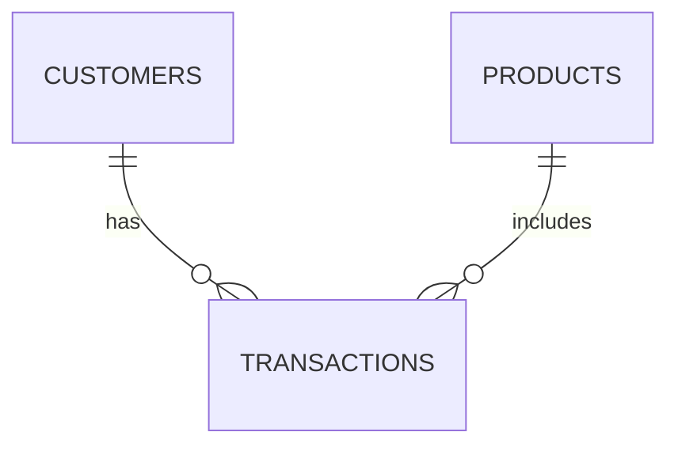

# Data Dictionary

## 1. Overview

This document defines the logical data model, dataset relationships, validation constraints, and analytical outputs used by Financial Data Processing.

All datasets contain synthetic financial information.

## 2. Source Datasets

### 2.1 Customers

**Source:** `data/raw/customers.csv`

**Primary key:** `customer_id`

| Column | Data Type | Required | Description |
|---|---|---|---|
| customer_id | String | Yes | Unique customer identifier |
| segment | String | Yes | Customer business segment |
| region | String | Yes | Geographic classification |

#### Validation Rules

- `customer_id` must not be null or blank.
- `customer_id` must be unique.
- `segment` must not be null.
- `region` must not be null.
- Leading and trailing whitespace is normalized.

### 2.2 Products

**Source:** `data/raw/products.csv`

**Primary key:** `product_id`

| Column | Data Type | Required | Description |
|---|---|---|---|
| product_id | String | Yes | Unique product identifier |
| product_type | String | Yes | Financial product classification |

#### Validation Rules

- `product_id` must not be null or blank.
- `product_id` must be unique.
- `product_type` must not be null.
- Leading and trailing whitespace is normalized.

### 2.3 Transactions

**Source:** `data/raw/transactions.csv`

**Primary key:** `transaction_id`

| Column | Data Type | Required | Description |
|---|---|---|---|
| transaction_id | String | Yes | Unique transaction identifier |
| customer_id | String | Yes | Reference to the customer |
| product_id | String | Yes | Reference to the product |
| amount | Numeric | Yes | Synthetic transaction amount |
| transaction_date | Datetime | No | Transaction date, when available |

#### Validation Rules

- `transaction_id` must be unique.
- `transaction_id` must not be null or blank.
- `customer_id` must exist in Customers.
- `product_id` must exist in Products.
- `amount` must be numeric.
- `amount` must be finite and greater than zero.
- `transaction_date`, when present, must contain valid dates.

The current data model supports positive transaction amounts. Refunds, reversals, and accounting adjustments requiring signed amounts are outside the current scope.

## 3. Data Relationships



### Customer Relationship

```text
transactions.customer_id = customers.customer_id
```

Cardinality: Many-to-one.

### Product Relationship

```text
transactions.product_id = products.product_id
```

Cardinality: Many-to-one.

Both relationships require valid references before enrichment.

## 4. Enriched Transactions

**Generated by:** `transformations.py`

**Output:** `enriched_transactions`

The enriched dataset combines transaction attributes with customer and product information.

| Column | Source | Description |
|---|---|---|
| transaction_id | Transactions | Transaction identifier |
| customer_id | Transactions | Customer reference |
| product_id | Transactions | Product reference |
| amount | Transactions | Transaction amount |
| transaction_date | Transactions | Optional transaction date |
| segment | Customers | Customer segment |
| region | Customers | Customer region |
| product_type | Products | Product classification |

Additional source attributes are preserved when they do not conflict with enrichment columns.

### Integrity Constraints

- The transaction count must be preserved.
- Customer relationships must be valid.
- Product relationships must be valid.
- Duplicate catalog keys are rejected.
- Null merge keys are rejected.
- Conflicting column names are rejected.

## 5. Analytical Datasets

### 5.1 Customer Metrics

**Generated by:** `calculate_customer_metrics()`

**Output:** `customer_metrics`

| Column | Type | Description |
|---|---|---|
| customer_id | String | Customer identifier |
| segment | String | Customer business segment |
| region | String | Customer region |
| transaction_count | Integer | Number of customer transactions |
| total_amount | Numeric | Sum of transaction amounts |
| average_amount | Numeric | Mean transaction amount |

Grouping dimensions:
- `customer_id`
- `segment`
- `region`

Only customers represented in the transaction dataset are included.

### 5.2 Product Metrics

**Generated by:** `calculate_product_metrics()`

**Output:** `product_metrics`

| Column | Type | Description |
|---|---|---|
| product_type | String | Product classification |
| transaction_count | Integer | Number of transactions |
| total_amount | Numeric | Sum of transaction amounts |
| average_amount | Numeric | Mean transaction amount |

Grouping dimension:
- `product_type`

### 5.3 Segment Metrics

**Generated by:** `calculate_segment_metrics()`

**Output:** `segment_metrics`

| Column | Type | Description |
|---|---|---|
| segment | String | Customer segment |
| transaction_count | Integer | Number of transactions |
| total_amount | Numeric | Sum of transaction amounts |
| average_amount | Numeric | Mean transaction amount |

Grouping dimension:
- `segment`

### 5.4 Overall Metrics

**Generated by:** `calculate_overall_metrics()`

**Output:** `overall_metrics`

| Field | Type | Description |
|---|---|---|
| transaction_count | Integer | Total number of transactions |
| unique_customers | Integer | Number of distinct customers |
| total_amount | Numeric | Sum of all transaction amounts |
| average_amount | Numeric | Mean transaction amount |

For an empty dataset, all overall metrics return zero.

## 6. Metric Definitions

### Transaction Count

```text
transaction_count = number of transaction records
```

### Total Amount

```text
total_amount = sum(amount)
```

### Average Amount

```text
average_amount = sum(amount) / transaction_count
```

For an empty dataset, the overall average is defined as zero.

### Unique Customers

```text
unique_customers = count(distinct customer_id)
```

## 7. Data Quality Rules

| Rule | Description | Module |
|---|---|---|
| Required columns | Verify mandatory fields | ingestion.py / validation.py |
| String normalization | Remove surrounding whitespace | cleaning.py |
| Blank normalization | Convert blank strings to null | cleaning.py |
| Duplicate detection | Identify duplicate records and keys | cleaning.py / validation.py |
| Primary key integrity | Reject null or duplicate identifiers | validation.py |
| Foreign key integrity | Validate customer and product references | validation.py |
| Numeric integrity | Reject invalid and non-finite amounts | validation.py |
| Date integrity | Validate available transaction dates | validation.py |
| Merge cardinality | Enforce many-to-one joins | transformations.py |
| Transaction preservation | Preserve transaction count | transformations.py |

## 8. Output Files

Generated files are written to the configured output directory.

Default project location:

```text
data/processed/
```

### Tabular Exports

| File | Format | Description |
|---|---|---|
| enriched_transactions.csv | CSV | Enriched transactions |
| enriched_transactions.parquet | Parquet | Columnar enriched transactions |
| customer_metrics.csv | CSV | Customer indicators |
| customer_metrics.parquet | Parquet | Columnar customer indicators |
| product_metrics.csv | CSV | Product indicators |
| product_metrics.parquet | Parquet | Columnar product indicators |
| segment_metrics.csv | CSV | Segment indicators |
| segment_metrics.parquet | Parquet | Columnar segment indicators |

### Summary Export

| File | Format | Description |
|---|---|---|
| overall_metrics.json | JSON | Overall financial indicators |

CSV and Parquet exports exclude the Pandas index.

## 9. Data Assumptions

- All records represent synthetic financial activity.
- Customer and product identifiers are fictional.
- Monetary amounts have no assigned currency.
- Transaction amounts represent activity volume, not revenue or profit.
- Average transaction amounts are calculated across transaction records.
- No exchange rate conversion is performed.
- No investment performance or risk indicators are calculated.
- Data processing uses in-memory Pandas DataFrames.
- Outputs are generated only when export is requested.